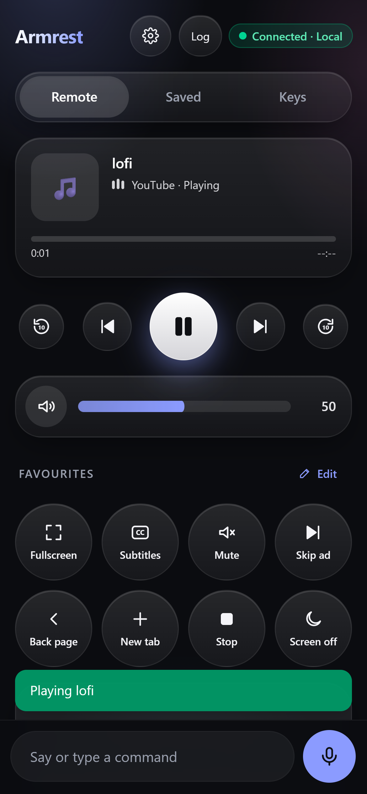

# Armrest

**Your PC, within arm's reach.** Turn any phone into the remote for the Windows PC on your TV.

<p align="center">
  
</p>

If your laptop or PC is plugged into the TV, you know the routine: get up, find the mouse, squint at a tiny button,
sit back down. Armrest fixes that. Scan a QR code on the TV once and your phone becomes a remote: say *"play lofi on
YouTube"*, drag the volume slider, skip the intro, or use your phone as a touchpad and keyboard.

- **No accounts, no app store install, no Wi-Fi settings.** Scan the code and you're in. It works on any phone with a
  browser and keeps working when you lock it.
- **Everyone on the couch gets a remote.** Friends scan the same code. Everyone sees what's playing, and button
  presses never collide.
- **Talk to it like a person.** "Turn on Spanish subtitles", "go back 30 seconds", "play at 1.25x", "open Netflix".
- **Built for the sofa.** If the browser crashes, it comes back signed in. If your internet drops, it switches to your
  home network.

> Formerly "Couch Jarvis": same app, same settings and paired phones.

---

## Get Armrest

| | |
|---|---|
| **Windows installer** | Download `CouchJarvis-Setup.exe` from the [latest release](https://github.com/NDNathanRocks/couch-jarvis/releases/latest) and run it. Updates install over the top; your settings and paired phones stay. |
| **Microsoft Store** | Coming soon. |
| **Phone** | Nothing to install. Scan the QR code on your TV. Optionally use *Add to Home Screen* for an app icon. |

You need Windows 10 or 11 with Microsoft Edge. A step-by-step guide, including the portable zip, is in
[docs/INSTALL.md](docs/INSTALL.md).

## Your first five minutes

1. **Install** Armrest on the PC that's connected to your TV. A short welcome window walks you through the setup.
2. **Sign in to your streaming sites** in the browser window Armrest opens on the TV (YouTube, Netflix and so on). It's
   a separate Edge profile just for the TV, so your everyday browsing stays separate.
3. **Scan the QR code** on the TV with your phone's camera and open the link. You're paired.
4. **Try it:** tap the mic and say *"play some jazz on YouTube"*, or use the buttons.
5. **Invite friends:** say *"pair a friend"* and the QR code comes back for them to scan.

## What you can do

### Buttons that feel like a real remote
- **Now playing** with a seek bar: drag to jump anywhere in the video or song.
- **Play controls:** previous, play/pause, next, back and forward 10 seconds.
- **Volume slider** that works like the iPhone's: drag anywhere on the bar and see the exact percentage.
- **Favourites:** eight buttons that are yours. Choose from fullscreen, exit fullscreen, subtitles, skip ad, duplicate
  tab, playback speed, screen off and more. You can also **make your own keyboard-shortcut buttons**, such as
  *Ctrl+Shift+T* "Reopen tab". Long-press any favourite to rearrange them.
- **Apps row:** one tap opens Netflix, YouTube, Prime Video, Disney+, Spotify, Twitch, Plex or Crunchyroll.

### Say it or type it
Tap the mic, speak, and tap send. Or type in the same bar. A few examples:

| Say | What happens |
|---|---|
| "play bruno mars on YouTube" | Searches and plays it |
| "pause" · "next" · "skip ahead 30 seconds" · "volume 40" | What you'd expect |
| "turn on subtitles" · "Spanish subtitles" · "subtitles off" | Works on YouTube and most video players |
| "fullscreen" · "exit fullscreen" | The video **and** the browser go fullscreen, so no tabs show on the TV |
| "change the speed to 1.25 times" · "normal speed" · "speed up" | Playback speed |
| "skip intro" · "next episode" · "play episode 5" | Clicks it on the page you're watching |
| "new tab" · "duplicate this tab" · "go back" · "close this tab" | Browser tabs and pages |
| "what's the weather today?" | Opens a web search on the TV |
| "set a sleep timer for 30 minutes" | Pauses the video when the time is up |

Common commands are understood instantly on your PC. Anything else goes to an optional AI helper that looks at
what's on the screen. The **[full list of commands](docs/COMMANDS.md)** has everything.

### A touchpad and keyboard in your pocket
- Drag to move the pointer, tap to click, use two fingers to scroll or right-click, and press and hold then drag to
  select. Choose Slow, Normal or Fast. A slow finger is precise and a quick flick crosses the whole TV.
- Type on your phone's keyboard straight into the TV, with arrows, Esc, F1-F12 and Ctrl/Alt/Shift shortcuts.

### Share it safely
- **Owner and guest phones:** guests get playback, volume and voice. Only owners get the touchpad, the keyboard and
  the settings.
- **Several TVs on one phone:** "Living room" and "Bedroom", switched from the header.
- Remove a phone at any time from the Armrest window on the PC, or make a new QR code so old ones stop working.

## Privacy, in plain words

- There are **no accounts**, and Armrest never asks for your name or email.
- Your phone talks to your PC through a small relay in the cloud, or directly on your home network. The relay passes
  messages along and keeps only what it needs to connect them.
- Voice is turned into text **on your PC** when it can be. Free optional cloud services (for example a Gemini key for
  smarter understanding) are off until you add them.
- Crash reports are **off** unless you switch them on, and they never include what you watch or say.

The details are in the [privacy policy](docs/PRIVACY.md).

## Good to know

- Armrest controls **one Edge window on the TV** (its own profile). The touchpad and keyboard can drive anything else
  on the PC.
- Some streaming sites limit what an automated browser can do. Armrest tells you on the phone when something didn't
  work, and the **Log** button says why.
- Over the internet, the touchpad has a small delay (usually under a third of a second).
- The microphone needs the hosted phone app (HTTPS). The backup home-network page can't record audio.
- Windows only, for now.

## Help

Start with the **Log** button on the phone. It shows what the PC heard and which step failed.

| Problem | Try this |
|---|---|
| "The PC is offline" | Make sure Armrest is running on the PC (Start menu → Armrest) and the PC is online |
| Voice commands aren't understood | Check the Log's `heard:` line. For free-form requests, set up the AI helper in the Armrest window |
| Fullscreen does nothing | Tap it again. Pages with ads sometimes swallow the first click |
| The phone shows plain volume buttons | The PC has an older Armrest. Install the latest version on the PC |
| The touchpad or keys are missing | This phone is a guest, or the touchpad and keys are switched off on the PC |

More answers are in [docs/INSTALL.md](docs/INSTALL.md#troubleshooting) and [docs/SUPPORT.md](docs/SUPPORT.md).

---

## For developers

Armrest is a Windows agent (Python), a serverless relay (AWS Lambda, API Gateway WebSocket and DynamoDB) and a phone
web app (React). [docs/DEVELOPING.md](docs/DEVELOPING.md) covers the architecture, running from source, the test
suites, deploying the relay and the phone app, building the installer, and the release rules every change follows.

```
 phones (web app)                AWS relay (serverless)                     your PC (Windows)
┌──────────────────┐  wss   ┌───────────────────────────────┐  wss   ┌───────────────────────────┐
│ voice, buttons   │◄──────►│ API Gateway WebSocket          │◄──────►│ Armrest app               │
│ touchpad, keys   │        │ Lambda (Python 3.12)           │        │  command queue            │
│ favourites, log  │        │ DynamoDB (rooms, phones)       │        │  agent: understand → act  │
└──────────────────┘        └───────────────────────────────┘        │   → check → recover       │
        └──────── home-network fallback: phone ⇄ PC directly ────────►│  Edge (CDP), Win32 input  │
                                                                      │  speech, TV overlay       │
                                                                      └───────────────────────────┘
```

## Licence

Armrest is proprietary software; see [LICENSE](LICENSE). The source is visible here for transparency and review.
Third-party components keep their own licences (`THIRD_PARTY_NOTICES.txt` ships with every build).
